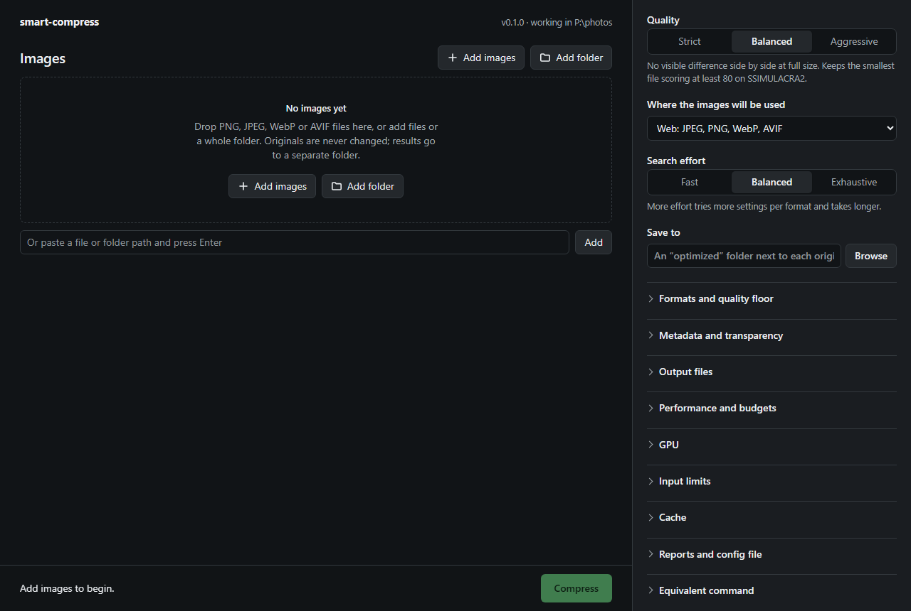

# lossy-and-found

[](https://github.com/FueledByRedBull/lossy-and-found/actions/workflows/ci.yml)

`smart-compress` makes JPEG, PNG, WebP and AVIF images smaller. For each image it
encodes the pixels with several codecs at several settings, scores every result
against the original with a perceptual metric, and keeps the smallest file that
stays above a quality level you choose. Your original is never overwritten.
(This repository is `lossy-and-found`; the program it builds is `smart-compress`.)

It is for people who have photos or web assets to shrink and would rather state a
quality level than guess a codec and a quality number for each file. It is slow by
design, because it makes tens of encodes per image: a 12 MP photo takes about half
a minute on seven cores.

## Requirements

- **Windows 11, x64.** This is the platform it is developed and tested on, and
  the only one CI builds on. Other platforms are untested; see
  [Platform notes](docs/usage.md#platform-notes).
- **Rust 1.94 or newer** to build it (edition 2024). CI uses the current stable
  release.
- **Encoder and metric programs**, run as separate processes. Only the PNG and
  JPEG encoders are built in. They are not stored in this repository: run

  ```powershell
  powershell -File tools\fetch-tools.ps1
  ```

  It downloads the official releases of libjxl 0.11.2 (JPEG XL, `cjpegli`, and
  the `ssimulacra2` score), libavif 1.4.2 (AVIF), libwebp 1.6.0 (WebP) and
  pngquant 2.17.0 (palette PNGs) into `tools/`, checks each against a pinned
  SHA-256, and keeps only the programs the optimizer runs and their licence
  files. [THIRD_PARTY_NOTICES.md](THIRD_PARTY_NOTICES.md) lists them with their
  licences. `oxipng` (smaller PNG files) is optional and is used if it is on
  `PATH`.

When a program is missing, the formats that need it are skipped and the report
lists it under "Missing optional tools"; nothing fails. With no `ssimulacra2`
the built-in score (a PSNR-derived measure with lower floors) decides instead,
which ranks codecs less reliably. A GPU is optional: the built-in score runs on
it when one is found, and on the CPU otherwise. See
[External tools](docs/usage.md#external-tools).

## Build

No release binaries are published; build from source:

```powershell
cargo build --release --bins
```

This builds `smart-compress.exe` (the command line), `smart-compress-app.exe`
(a windowed launcher for the control panel; it must stay next to
`smart-compress.exe`) and `smart-compress-benchmark.exe`, in `target\release`.

## Quick start

```powershell
# One image; the result goes to an "optimized" folder next to it
target\release\smart-compress.exe photo.jpg

# A folder of images, with a chosen output folder and a JSON report
target\release\smart-compress.exe .\photos --recursive --out-dir out --report json --report-out report.json

# See what would be processed without encoding anything
target\release\smart-compress.exe photo.jpg --dry-run
```

Choose the quality with `--preset`: `strict` (SSIMULACRA2 floor 90, visually
lossless), `balanced` (80, the default, no visible difference side by side) or
`aggressive` (70). `--target` chooses which formats may win: the default `web`
tries JPEG, WebP, AVIF and PNG and prefers the more widely supported one when it
is within a few percent of the smallest; `smallest` also tries JPEG XL and picks
purely on size; `max-compat` tries only JPEG and PNG.

If no candidate is both smaller than the original and above the floor, nothing is
written, the original is untouched, and the image is reported as kept. That is
not an error: the exit status is 1 only when an image failed. A second run on the
same inputs skips images whose output already exists unless you pass
`--overwrite`. Every option, the defaults, the report layout and the
configuration file are in [docs/usage.md](docs/usage.md).

An example run, with the default settings and the report shortened (`[...]`
marks what was left out):

```text
> smart-compress samples/photos/picsum-433-3200x2400.jpg --out-dir optimized --workers 6
Original: 633331 bytes, 3200x2400, Photo, decoded Rgb8, source Rgb8
[...]
Winner: Avif q67/e6 -> 455682 bytes
Output: optimized\picsum-433-3200x2400.avif
[...]
Failures: 0
Summary: 1 improved, 0 kept as they were, 0 skipped, 0 failed
```

The 633,331-byte JPEG became a 455,682-byte AVIF (28% smaller) that scores 80.8
on SSIMULACRA2 against a floor of 80. It took 17 seconds, on six cores pinned with
`--workers 6`. The default text report also prints a table of all 19 candidates:

| Codec | Settings | Size (bytes) | SSIMULACRA2 | Status |
|---|---|---:|---:|---|
| Jpeg | q78/e0 | 661230 | - | rejected: not smaller than original |
| Webp | q78/e4 | 396126 | 70.1 | rejected: quality below 80.0 |
| Avif | q78/e8 | 590085 | 83.6 | accepted |
| Webp | lossless | 3416746 | - | rejected: not smaller than original |
| Jpeg | q60/e0 | 470523 | 76.8 | rejected: quality below 80.0 |
| Webp | q92/e4 | 809914 | - | rejected: not smaller than original |
| Avif | q60/e8 | 400901 | 77.0 | rejected: quality below 80.0 |
| Webp | q60/e4 | 294758 | 61.3 | rejected: quality below 80.0 |
| Jpeg | q92/e0 | - | - | skipped: assumed to pass |
| Avif | lossless | - | - | skipped: cannot win |
| Avif | q92/e8 | - | - | skipped: assumed to pass |
| Png | lossless | - | - | skipped: cannot win |
| Jpeg | q67/e0 | 534122 | 78.4 | rejected: quality below 80.0 |
| Jpeg | q69/e0 | 557926 | 80.1 | accepted |
| Jpeg | q71/e0 | 582296 | 81.3 | accepted |
| Avif | q66/e6 | 431882 | 79.9 | rejected: quality below 80.0 |
| Avif | q68/e6 | 471336 | 81.3 | accepted |
| Avif | q70/e6 | 481797 | 81.7 | accepted |
| Avif | q67/e6 | 455682 | 80.8 | accepted (winner) |

Qualities above or below an already-tested point are skipped as "assumed to pass"
instead of being encoded, and candidates that cannot beat the best so far are
skipped as "cannot win". The report gives the reason for each.

**Measured result.** On the six larger stock photos in `samples/photos/` (7,593,517 bytes
together), the balanced preset (SSIMULACRA2 floor 80) with `--target smallest`
produces 5,940,628 bytes, 21.8% smaller. Individual photos range from 14% to 44%
smaller. These photos were already lossy JPEGs, which limits the gain; the strict
preset (floor 90) finds no smaller file for any of them. Method, timings, memory
and the other measurements are in [docs/benchmarking.md](docs/benchmarking.md).

## The desktop app



Double-click `gui.cmd` (it builds first if the program is missing) or
`target\release\smart-compress-app.exe`. It opens a window with a page that is
compiled into the executable and served on `127.0.0.1` only, behind a per-session
token. Drop images onto it or use the file dialogs, change any setting, watch
progress, cancel, and compare each result with its original. It drives the same
optimizer as the command line, in the same process, and shows the equivalent
command. The window is Microsoft Edge in app mode, falling back to a browser tab.
`smart-compress --gui` serves the same page to your default browser instead.

## How it decides

1. It reads the image, checks its content against its extension, applies the EXIF
   orientation to the pixels, and classifies it (photo, screenshot, transparent
   asset, simple graphic).
2. It encodes candidates from the decoded original pixels with each allowed codec
   at a few qualities. Qualities around where each codec crosses the floor are
   found by bracketing and interpolation, not by trying every setting, and
   candidates that cannot win are skipped and reported as skipped.
3. It decodes every candidate and scores it against the original. The deciding
   score is SSIMULACRA2 when its program is present. Transparent images must also
   pass whole-channel and local alpha checks.
4. It keeps the smallest candidate that is smaller than the original and at or
   above the floor, preferring the more compatible format inside the preset's
   allowance, and writes it atomically.

Memory, threads, temporary disk and time are budgeted: `--workers` is a real cap
on threads, and work waits instead of exceeding the memory plan. Reports (text,
JSON or Markdown) list every candidate with its size, score, timing and reason for
rejection or skipping. The details are in [docs/usage.md](docs/usage.md).

## Known limits

- **No colour conversion.** An output carries the source's colour profile
  unchanged. A source whose colour it cannot carry (a non-sRGB PNG tagged by
  `cICP`, `gAMA` or `cHRM`, an AVIF with a non-sRGB colour triple, a CMYK JPEG with
  its own profile) is refused with the reason in the report.
- **No HDR**, and no wide-gamut output beyond carrying an ICC profile.
- **No animation.** GIF, animated WebP, APNG and animated AVIF are rejected. SVG,
  BMP, TIFF and JPEG XL files are not accepted as input either.
- **No resizing or cropping.** Dimensions never change.
- **Windows first.** Process-tree termination, the Ctrl+C handler, physical-memory
  detection, the app window and native file dialogs are Windows-only. The code
  compiles for other targets by reading only; nothing else has been tested.
- **No hardware encoders.** All encoding is done in software by the programs
  above.
- **Not fast.** With a seven-core cap a single photo takes about 12 s at 3.8 MP, 32 s at
  12 MP and 42 s at 16.7 MP. The 3.8 MP and 12 MP times miss the latency
  gates in the benchmarking document.
- **The scoring has limits.** Images above 16 MP are scored on a mosaic of
  full-resolution samples, so a small busy region between samples can be missed.
  The built-in score used without `ssimulacra2` is not perceptual. The shortcut
  that skips lossless encodes for JPEG sources rests on measurements, not a proof.

## Status

Version 0.1.0, before a first release. It is maintained by one person, tested on
Windows 11 only, and flags, defaults and the report layout can still change
(reports carry a schema version, currently 6). Open work is in
[ROADMAP.md](ROADMAP.md). Bug reports and measured improvements are welcome; see
[CONTRIBUTING.md](CONTRIBUTING.md). To report a vulnerability, see
[SECURITY.md](SECURITY.md).

## Documentation

- [docs/usage.md](docs/usage.md): every option, defaults, quality scoring, colour
  and metadata rules, reports, configuration file, platform notes.
- [docs/benchmarking.md](docs/benchmarking.md): method, results, how to reproduce.
- [docs/maintainers.md](docs/maintainers.md) and [docs/release.md](docs/release.md):
  CI, tests that depend on the machine, packaging.
- [ROADMAP.md](ROADMAP.md): open work and decisions against.

## Licence

`smart-compress` is available under either the [MIT](LICENSE-MIT) or the
[Apache-2.0](LICENSE-APACHE) licence, at your option. The encoder programs it
runs are third-party software under their own licences, listed in
[THIRD_PARTY_NOTICES.md](THIRD_PARTY_NOTICES.md); they are downloaded, not
included in this repository. The photographs in `samples/photos/` are not covered
by the project licence: they are Unsplash photos under the Unsplash License,
listed in [samples/photos/SOURCES.md](samples/photos/SOURCES.md).

## Acknowledgements

`smart-compress` runs and depends on the work of others: the
[libjxl](https://github.com/libjxl/libjxl) project (JPEG XL, jpegli and the
SSIMULACRA 2 metric tool), [libavif](https://github.com/AOMediaCodec/libavif) with
aom and dav1d, [libwebp](https://developers.google.com/speed/webp), pngquant by
Kornel Lesinski, and [oxipng](https://github.com/oxipng/oxipng). The Rust crates
it builds on include `wgpu`, `image`, `clap`, `rayon` and `serde` (see
`Cargo.lock`). The sample photographs are published on Unsplash and served by
[Lorem Picsum](https://picsum.photos); their photographers are credited in
`samples/photos/SOURCES.md`.
